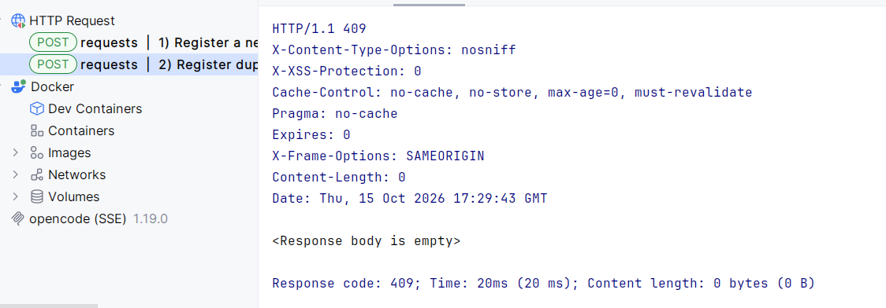
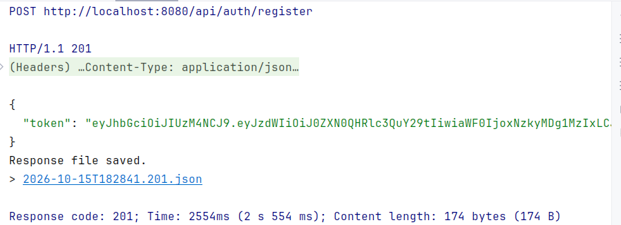
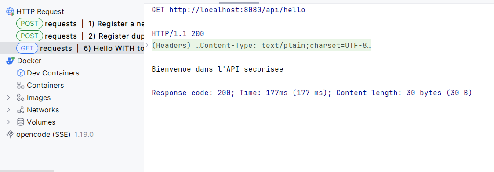
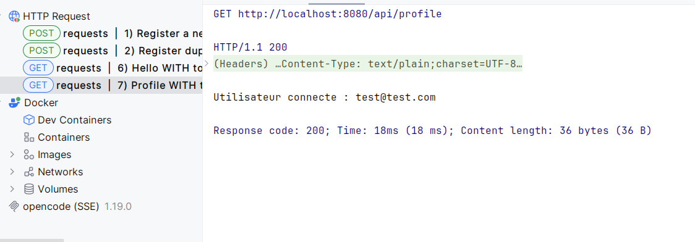

<!-- CSS: rendered by GitHub-compatible viewers that allow styles; harmless elsewhere -->
<style>
  .tp-hero {
    text-align: center;
    padding: 28px 16px;
    border-radius: 18px;
    background: linear-gradient(135deg, #0f2027 0%, #203a43 50%, #2c5364 100%);
    color: #ffffff;
    box-shadow: 0 10px 30px rgba(0, 0, 0, 0.25);
  }
  .tp-hero h1 { margin: 0; font-size: 2.1rem; letter-spacing: 0.5px; }
  .tp-hero p  { margin: 8px 0 0; opacity: 0.9; }
  .tp-badge   { display: inline-block; margin: 3px; }
  .tp-card {
    border: 1px solid #e1e4e8;
    border-left: 5px solid #6f42c1;
    border-radius: 10px;
    padding: 14px 18px;
    margin: 14px 0;
    background: #faf9ff;
  }
  .tp-card code { background: #efe9ff; }
</style>

<div class="tp-hero" align="center">
  <h1>TP 2: Authentification avec JWT et Spring Security</h1>
  <p>Secure REST API - register, login, and access protected endpoints with a signed JWT</p>
  <p><b>Author: Mouss Ilyas</b></p>
</div>

<div align="center">


</div>

---

## Overview

<div class="tp-card">

A **Spring Boot** REST API protected by **Spring Security** and **JWT**.
Users register, log in, and receive a signed token that is sent on every
protected request. Passwords are hashed with **BCrypt**; the API is fully
**stateless** (no server session).

</div>

## Tech Stack

<table>
  <tr><td><b>Language</b></td><td>Java 21</td></tr>
  <tr><td><b>Framework</b></td><td>Spring Boot 4.1.1</td></tr>
  <tr><td><b>Security</b></td><td>Spring Security + JWT (JJWT 0.13.0)</td></tr>
  <tr><td><b>Persistence</b></td><td>Spring Data JPA · H2 (in-memory)</td></tr>
  <tr><td><b>Build</b></td><td>Maven (wrapper)</td></tr>
  <tr><td><b>Extra</b></td><td>Lombok</td></tr>
</table>

## Project Structure

```text
com.projectJwtspringapplication/
├── JwtSpringApplication.java        # Entry point
├── config/
│   └── SecurityConfig.java          # Security rules, filter chain, encoder
├── controller/
│   ├── AuthController.java          # /api/auth/register, /api/auth/login
│   └── UserController.java          # /api/hello, /api/profile (protected)
├── dto/                             # AuthResponse, LoginRequest, RegisterRequest
├── entity/AppUser.java              # User entity ("users" table)
├── repository/UserRepository.java   # JPA repository (findByEmail, existsByEmail)
├── security/
│   └── JwtFilter.java               # Validates the Bearer token per request
└── service/
    ├── JwtService.java              # Token generation / validation
    └── CustomUserDetailsService.java
```

## API Endpoints

| Method | Path                 | Access            | Description                    |
|:------:|----------------------|-------------------|--------------------------------|
| `POST` | `/api/auth/register` | 🟢 Public         | Create a user, returns a JWT   |
| `POST` | `/api/auth/login`    | 🟢 Public         | Authenticate, returns a JWT    |
| `GET`  | `/api/hello`         | 🔒 Authenticated  | Protected greeting             |
| `GET`  | `/api/profile`       | 🔒 Authenticated  | Returns the authenticated user |

<div class="tp-card">

Send the token on protected calls:

```http
Authorization: Bearer <token>
```

</div>

## Configuration · `application.properties`

```properties
spring.datasource.url=jdbc:h2:mem:securitydbdemo
spring.jpa.hibernate.ddl-auto=update
jwt.secret=<base64-secret>
jwt.expiration=3600000
```

## Run

```bash
./mvnw spring-boot:run
# API:        http://localhost:8080
# H2 console: http://localhost:8080/h2-console
```

## API Tests

All requests live in [`requests.http`](requests.http) - open it in IntelliJ IDEA
and click ▶ next to each request. The screenshots below show the responses.

<details open>
<summary><b>Register duplicate → <code>409 Conflict</code></b> (author: Mouss Ilyas)</summary>

<br>

<div align="center">
  
</div>

</details>

<details open>
<summary><b>Login → <code>200 OK</code></b></summary>

<br>

<div align="center">
  
</div>

</details>

<details open>
<summary><b>Hello with token → <code>200 OK</code></b></summary>

<br>

<div align="center">
  
</div>

</details>

<details open>
<summary><b>Profile with token → <code>200 OK</code></b></summary>

<br>

<div align="center">
  
</div>

</details>

---

## Author

<div align="center">

**Mouss Ilyas**

</div>

## Notes

- Store the JWT secret in environment variables, never in version control.
- Passwords are hashed with **BCrypt** before being persisted.
